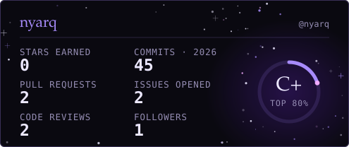
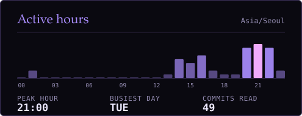

<!-- Header banner -->

  

<!-- Typing header -->

  
   
  

### About

### Tech Stack

<table>
  <tr>
    <td align="center"><b>Languages</b></td>
    <td>
      
      
      
    </td>
  </tr>
  <tr>
    <td align="center"><b>Web &amp; App</b></td>
    <td>
      
      
      
    </td>
  </tr>
  <tr>
    <td align="center"><b>Tools</b></td>
    <td>
      
      
    </td>
  </tr>
</table>

### Stats

  

  

  

<!-- Streak -->

  

<!-- Activity Graph -->

  

<!-- Snake: collapsed by default, the animated SVG keeps repainting while visible -->

  

    
<b>Contribution Snake</b>

     
    
  

<!-- Footer banner -->

  

